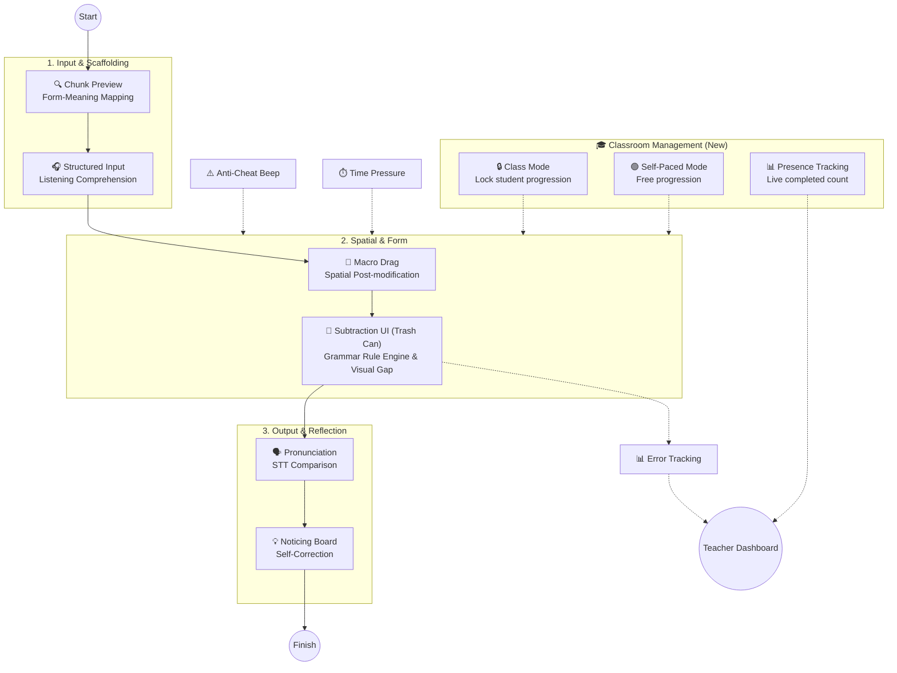
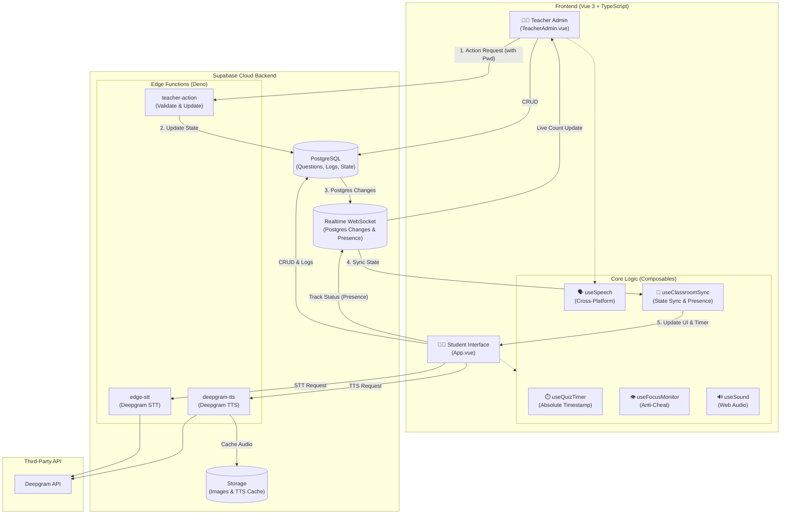
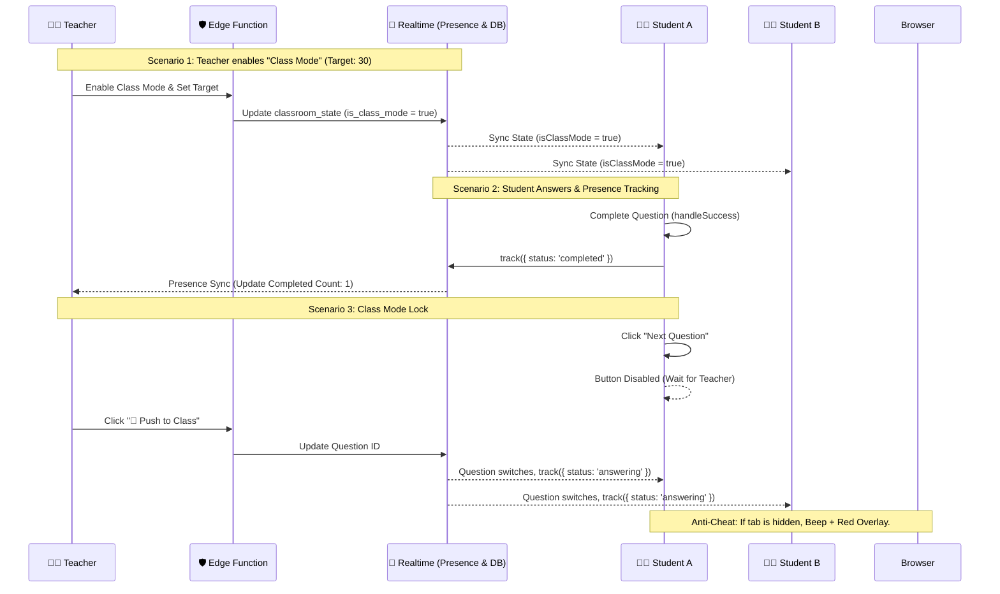

# 🕵️ Anime Character Hunter Lite

**[English](README.md) | [繁體中文](README.zh-TW.md)**

An interactive, cognitive-pipeline-driven English grammar learning tool designed for K-12 education.

Built with **Vue 3, TypeScript, Vite, and Supabase**, this application takes a pedagogical approach to teaching **Post-modifiers (Relative Clauses & Prepositional Phrases)**, specifically targeting the common L1 interference (Chinese pre-modifiers vs. English post-modifiers), structural misconceptions (e.g., redundant pronouns like `who she`), and **Phrase Chunking**.

It is designed around a single 45-minute lesson for **Grade 9 (115 iE5, Unit 5: *The Man Who Shook Hands with Me Is My Favorite Star*)**, covering Grammar Focus 1 (prepositional phrases), Grammar Focus 2 (subject relative clauses with *who / which / that*), and the p.107 Read activity.

---

## 🧠 The Cognitive Pipeline (Pedagogy-Driven Design)

This app is built upon Second Language Acquisition (SLA) theories and features **three distinct question types**, guiding students through a specific cognitive loop:



1. **Chunk Phrase Quiz**: Establishes Form-Meaning Mapping.
2. **Macro Drag & Contrast Puzzle**: Builds a spatial sense of English post-modification (no text labels to prevent answer leaking).
3. **Standard & Reduce**: Features Input Processing, Focus on Form using a unique **"Trash Can" subtraction mechanic**, Prosody Output, and Consciousness-Raising.

---

## 🏗️ System Architecture

The system is highly decoupled, using **Supabase** as the central hub to connect the Vue 3 frontend, teacher admin, and external AI speech services.



---

## 🎙️ Hybrid Speech Architecture

To ensure 100% stability across all devices (iPads, computers, and smart whiteboards with no system voice packs), this app implements a robust **fallback mechanism**.

- **TTS**: Detects native voices. If none, routes to **Deepgram TTS** via Supabase Edge Function.
- **STT**: Bypasses browser restrictions by sending audio to **Deepgram STT** via Supabase Edge Function.

---

## ⚡ Real-time Classroom Flow (Master-Slave & Anti-Cheat)

This sequence diagram illustrates the **Class Mode Lock**, **Presence Tracking**, and **Anti-Cheat** mechanisms.



---

## ✨ Key Features

### For Students
- **Trash Can Subtraction UI (Reduce Mode)**: Students see the complete sentence and physically discard redundant words into a trash can, witnessing the sentence shrink.
- **Class Mode Lock**: When the teacher enables Class Mode, the "Next" button is disabled. Students must wait for the teacher's push command.
- **Phrase Chunking Visuals**: Multi-word units appear as distinct blue tiles.
- **Randomized Audio**: TTS randomly selects from a pool of voices.
- **Text-Diff Pronunciation Panel**: Record your voice via Deepgram STT.

### For Teachers (Teacher Admin)
- **Presence Dashboard**: Input the target student count. Watch the live progress bar (`completed / target`) update in real-time as students finish.
- **Class Mode Toggle**: Lock the entire class's progression instantly. Perfect for synchronized classroom teaching.
- **Funnel-Based Authoring**: Wrap phrases in `[ ]`. Visualizes "Kept" and "Discarded" words. If a verb needs to become a preposition, edit the green box.
- **Master Remote Control**: Push questions, force-reset timers, and add time (`+30s`) instantly.

---

## 🔬 Diagnostic Rule Engine

| Code | Triggered when | What it tells the teacher |
| :--- | :--- | :--- |
| `DUPLICATE_PRONOUN` | A subject pronoun follows *who / which / that*. | The student doesn't see the relative pronoun replaces the noun. |
| `SV_AGREEMENT` | The verb disagrees with the antecedent's number. | The student hasn't mastered verb agreement. |
| `WRONG_RELATIVE` | *who* for a thing, or *which* for a person. | The student can't choose the pronoun by antecedent type. |
| `NOT_REDUCED` | In a **reduce** question, the relative pronoun is still present. | The student didn't apply the conversion. |
| `INCOMPLETE_REDUCTION` | The pronoun is gone but a *be* verb is left. | The student removed the pronoun but not the *be* verb. |
| `WRONG_ORDER` | Grammar is fine but tile order differs. | Word order is off. |
| `PUZZLE_ERROR` | Puzzle piece misses the target slot. | Lacks spatial sense of post-modification. |

---

## 🛠️ Tech Stack & Engineering

- **Frontend**: Vue 3 (Composition API) + Vite + TypeScript
- **Backend & DB**: Supabase (PostgreSQL, Storage, Edge Functions, Realtime Presence)
- **Speech**: Deepgram API (via Edge Function proxy) + Native Web Speech API fallback
- **Drag & Drop**: Native Pointer Events & `vue-draggable-plus`

---

## 🚀 Getting Started

### Environment Setup
Create a `.env.local` file:
```env
VITE_SUPABASE_URL=your_supabase_project_url
VITE_SUPABASE_ANON_KEY=your_supabase_anon_key
```

### Supabase Setup
1. Create a **Public** Storage bucket named `tts-audio`.
2. Create a table `classroom_state` and enable Realtime (`supabase_realtime`).
3. Deploy the Edge Functions:
   ```bash
   npx supabase functions deploy deepgram-tts
   npx supabase functions deploy edge-stt
   npx supabase functions deploy teacher-action
   ```
4. Set the Secrets:
   ```bash
   npx supabase secrets set DEEPGRAM_API_KEY=your_deepgram_key
   npx supabase secrets set TEACHER_PASSWORD=your_teacher_password
   ```

### Development & Testing
```bash
npm install
npm run dev
npm test
```