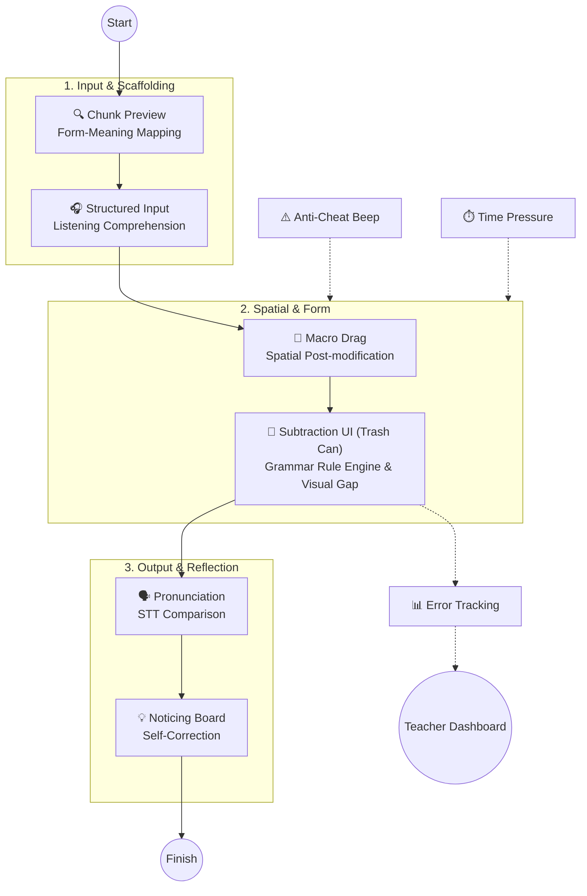
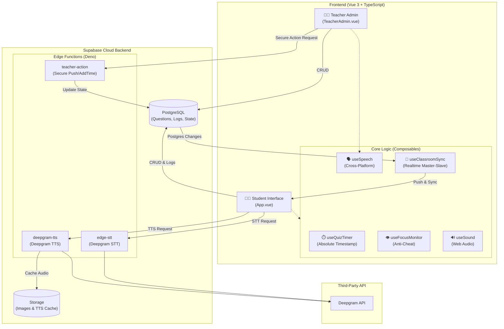
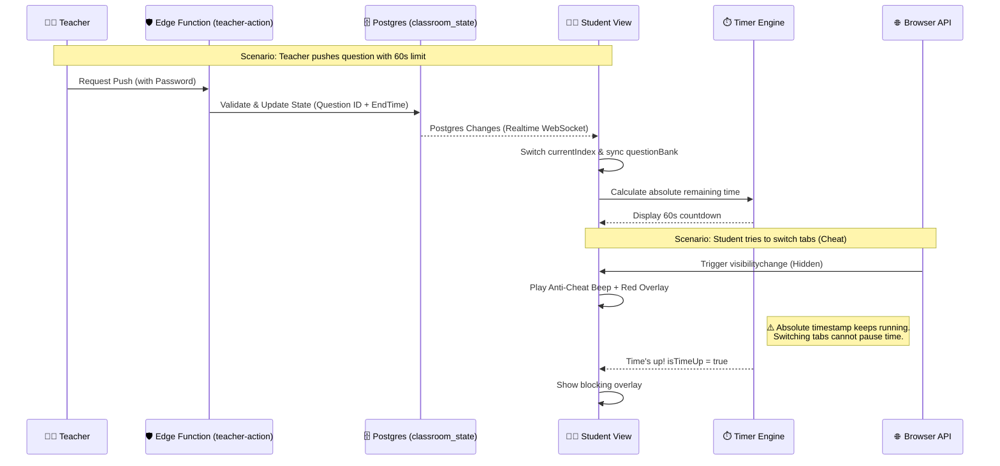

# 🕵️ Anime Character Hunter Lite

**[English](README.md) | [繁體中文](README.zh-TW.md)**

An interactive, cognitive-pipeline-driven English grammar learning tool designed for K-12 education.

Built with **Vue 3, TypeScript, Vite, and Supabase**, this application takes a pedagogical approach to teaching **Post-modifiers (Relative Clauses & Prepositional Phrases)**, specifically targeting the common L1 interference (Chinese pre-modifiers vs. English post-modifiers), structural misconceptions (e.g., redundant pronouns like `who she`), and **Phrase Chunking**.

It is designed around a single 45-minute lesson for **Grade 9 (115 iE5, Unit 5: *The Man Who Shook Hands with Me Is My Favorite Star*)**, covering Grammar Focus 1 (prepositional phrases), Grammar Focus 2 (subject relative clauses with *who / which / that*), and the p.107 Read activity.

---

## 🧠 The Cognitive Pipeline (Pedagogy-Driven Design)

This app is built upon Second Language Acquisition (SLA) theories and features **three distinct question types**, guiding students through a specific cognitive loop:



1. **Chunk Phrase Quiz (Lexical Chunking)**: Students listen and select the correct chunk to establish Form-Meaning Mapping.
2. **Macro Drag & Contrast Puzzle (Spatial Construction)**: Students physically drag image blocks (without text labels) to build a spatial sense of English post-modification.
3. **Standard & Reduce (Input, Form, & Output)**: Features Input Processing, Focus on Form using a unique **"Trash Can" subtraction mechanic**, Prosody Output (TTS/STT), and Consciousness-Raising.

---

## 🏗️ System Architecture

The system is highly decoupled, using **Supabase** as the central hub to connect the Vue 3 frontend, teacher admin, and external AI speech services.



---

## 🎙️ Hybrid Speech Architecture

To ensure 100% stability across all devices (iPads, computers, and smart whiteboards with no system voice packs), this app implements a robust **fallback mechanism**.

- **TTS (Text-to-Speech)**: Detects if the device has system voices. If yes, it randomly selects a native English voice. If no (common on Windows smart whiteboards), it routes to a Supabase Edge Function that generates high-quality neural audio via **Deepgram TTS**.
- **STT (Speech-to-Text)**: Bypasses browser-specific API restrictions (like `service-not-allowed` on Safari) by securely sending audio through a Supabase Edge Function to **Deepgram STT**.

---

## ⚡ Real-time Classroom Flow (Master-Slave & Anti-Cheat)

This sequence diagram illustrates the "Teacher Control" (via secure Edge Function), the "Silent Sync", and the "Anti-Cheat" mechanisms.



---

## ✨ Key Features

### For Students
- **Trash Can Subtraction UI (Reduce Mode)**: Instead of unscrambling from scratch, students see the complete relative clause and physically click to discard redundant words (e.g., `who`, `is`) into a trash can, visually witnessing the sentence shrink into a prepositional phrase.
- **Phrase Chunking Visuals**: Multi-word units (e.g., `[in a blue uniform]`) appear as distinct blue tiles.
- **Randomized Audio**: TTS randomly selects from a pool of voices to provide varied auditory input.
- **Instant Guided Feedback**: Red highlighting and shake animations for grammar errors.
- **Text-Diff Pronunciation Panel**: Record your voice via Deepgram STT, compare it with the target sentence, and see exactly which words were missed.

### For Teachers (Teacher Admin)
- **Funnel-Based Authoring (Reduce Mode)**: Wrap the core phrase in `[ ]` (e.g., `who is carrying [a dictionary]`). The system visually previews the "Kept" (green) and "Discarded" (red) words. If a verb needs to become a preposition (e.g., `carrying` -> `with`), simply edit the green box, and the system dynamically injects the new word into the student's tile bank.
- **Master Remote Control**: A seamless Master-Slave architecture using Supabase Realtime. Teachers can push specific questions to the whole class, force-reset timers, and add time (`+30s`) instantly.
- **Classroom Pace Control**: Toggle between "Free Pace" (🟢) and "Timed Challenge" (🔴) per question.
- **Interactive Distractor Tags**: Quickly add misconception tiles (e.g., `she`, `wear`, `which`) with one click.
- **Class-wide Analytics Dashboard**: Aggregates student error events into real-time bar charts.

---

## 🔬 Diagnostic Rule Engine

Student mistakes are classified into **diagnostic codes**. The grammar rules are pure functions in `src/rules/grammarRules.ts`.

| Code | Triggered when | What it tells the teacher |
| :--- | :--- | :--- |
| `DUPLICATE_PRONOUN` | A subject pronoun follows *who / which / that*. | The student doesn't see the relative pronoun replaces the noun. |
| `SV_AGREEMENT` | The verb disagrees with the antecedent's number. | The student hasn't mastered verb agreement. |
| `WRONG_RELATIVE` | *who* for a thing, or *which* for a person. | The student can't choose the pronoun by antecedent type. |
| `NOT_REDUCED` | In a **reduce** question, the relative pronoun is still present. | The student didn't apply the conversion. |
| `INCOMPLETE_REDUCTION` | The pronoun is gone but a *be* verb is left. | The student removed the pronoun but not the *be* verb. |
| `WRONG_ORDER` | Grammar is fine but tile order differs. | Word order is off. |
| `PUZZLE_ERROR` | Puzzle piece misses the target slot. | Lacks spatial sense of post-modification. |

---

## 🛠️ Tech Stack & Engineering

- **Frontend**: Vue 3 (Composition API) + Vite + TypeScript
- **Backend & DB**: Supabase (PostgreSQL, Storage, Edge Functions, Realtime)
- **Speech (TTS & STT)**: Deepgram API (via Edge Function proxy) + Native Web Speech API fallback
- **Drag & Drop**: Native Pointer Events & `vue-draggable-plus`

---

## 🚀 Getting Started

### Environment Setup
Create a `.env.local` file:
```env
VITE_SUPABASE_URL=your_supabase_project_url
VITE_SUPABASE_ANON_KEY=your_supabase_anon_key
```

### Supabase Setup
1. Create a **Public** Storage bucket named `tts-audio`.
2. Create a table `classroom_state` and enable Realtime (`supabase_realtime`).
3. Deploy the Edge Functions:
   ```bash
   npx supabase functions deploy deepgram-tts
   npx supabase functions deploy edge-stt
   npx supabase functions deploy teacher-action
   ```
4. Set the Secrets:
   ```bash
   npx supabase secrets set DEEPGRAM_API_KEY=your_deepgram_key
   npx supabase secrets set TEACHER_PASSWORD=your_teacher_password
   ```

### Development & Testing
```bash
npm install
npm run dev
npm test
```

---

## 📚 Pedagogical References
- Processing Instruction (PI): VanPatten (1996)
- Noticing Hypothesis: Schmidt (1990)
- PACE Model: Adair-Hauck & Donato (2002)
- Focus on Form: Long (1991)

