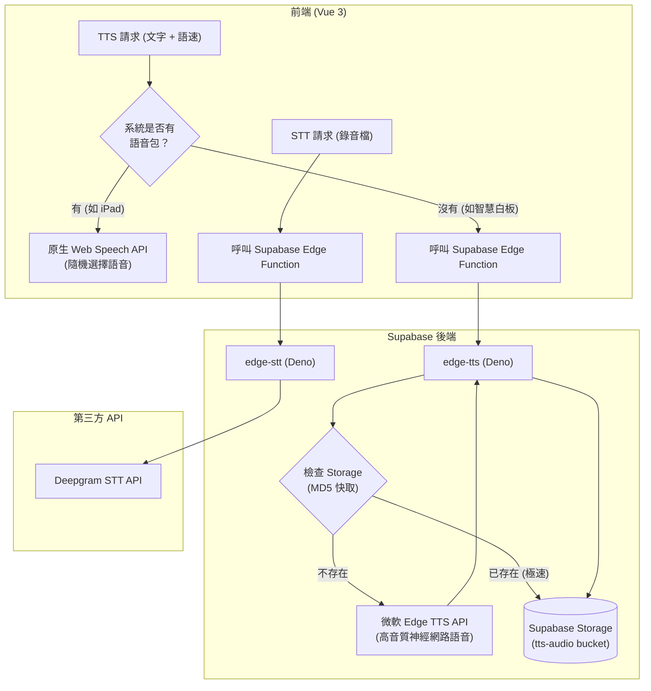

# 🕵️ Anime Character Hunter Lite（動漫角色大搜尋）

**[English](README.md) | [繁體中文](README.zh-TW.md)**

一套以「認知歷程管線」為核心、專為 K-12 設計的互動式英語文法學習工具。

本專案以 **Vue 3、TypeScript、Vite 與 Supabase** 打造，教學主題為**後位修飾（關係子句與介系詞片語）**，特別針對母語干擾（中文為前位修飾、英文為後位修飾）與結構性迷思（例如 `who she` 這類多餘代名詞）。

整體設計對應一節 45 分鐘的**國三（115 iE5 Unit 5：*The Man Who Shook Hands with Me Is My Favorite Star*）**課程。

## 🧠 認知歷程管線（以教學理論驅動的設計）

本工具建立在第二語言習得（SLA）理論上，包含三種獨立的題型，帶領學生完成認知循環：

1. **片語預習與測驗 (Chunk Phrase Quiz)**：學生看圖聽發音，從相似片語中選出正確的，建立「形式與意義的連結」。
2. **空間建構 (Contrast Puzzle)**：學生親手把拼圖塊拖過中線，建立英文後位修飾的空間語序感。
3. **標準題 (Standard Question)**：
   - **輸入處理**：聽句子選圖片。
   - **聚焦形式**：排列字磚，系統自動偵測文法迷思。
   - **韻律與輸出**：採用**跨平台混合式語音架構**（詳見下節）。
   - **意識提升**：透過解說卡與 Noticing Board 自行歸納文法規則。

## 🎙️ 跨平台混合式語音架構 (Hybrid TTS & STT)

為了確保在 iPad、一般電腦、以及**沒有語音包的智慧白板**上都能 100% 穩定運作，本專案實作了基於 Supabase Edge Functions 的**降級備援機制**。



- **文字轉語音 (TTS)**：優先偵測系統原生語音包（並隨機選擇男女聲）。若無語音包（如 Windows 白板），則自動呼叫 `edge-tts` 代理，取得微軟高音質 AI 語音，並以 MD5 雜湊儲存於 Supabase Storage 作為快取。
- **語音轉文字 (STT)**：完全繞過瀏覽器 Web Speech API 的限制（如 Safari 的 `service-not-allowed`），將錄音檔傳送至 `edge-stt` 代理，交由 **Deepgram** 進行精準辨識。

## ✨ 主要功能

### 給學生
- **片語塊視覺化**：多字片語（如 `[in a blue uniform]`）顯示為不可分割的藍色磚塊。
- **隨機語音輸入**：每次播放皆會從語音池中隨機選擇不同聲音，增加聽力豐富度。
- **即時引導式回饋**：文法錯誤時以紅字標示並搖晃。
- **文字比對發音面板**：透過 Deepgram 辨識發音，精準畫線標示漏讀單字。若網路斷線，具備優雅的降級回放機制。

### 給老師（Teacher Admin）
- **三大獨立題型**：標準題、對比題、片語題。
- **免寫程式的出題器**：用 `[ ]` 包住片語即可產生字磚；支援自訂克漏字上下文與 0.5 / 0.8 / 1.0 三段語速設定。
- **全班分析儀表板**：將錯誤事件彙整成即時圖表。

## 🔬 診斷規則引擎

學生的錯誤會被歸類為**診斷碼**。文法規則是純函式，位於 `src/rules/grammarRules.ts`。

| 診斷碼 | 觸發情境 | 教學診斷意義 |
|---|---|---|
| `DUPLICATE_PRONOUN` | *who / which / that* 後面緊接主格代名詞。 | 學生尚未理解關代已代替先行詞。 |
| `SV_AGREEMENT` | 關代後的動詞與先行詞單複數不一致。 | 尚未掌握關係子句內的動詞呼應。 |
| `WRONG_RELATIVE` | 先行詞是物卻用 *who*，或人卻用 *which*。 | 無法依先行詞類型選擇關代。 |
| `NOT_REDUCED` | 轉換題中仍保留 *who / which / that*。 | 沒有把關係子句簡化為介系詞片語。 |
| `INCOMPLETE_REDUCTION` | 關代已刪除，但 be 動詞仍殘留。 | 刪了關代，卻忘了刪 be 動詞。 |
| `WRONG_ORDER` | 文法正確但字序錯誤。 | 語序錯亂或選錯連接詞。 |
| `PUZZLE_ERROR` | 拼圖塊未對準目標槽位。 | 缺乏後位修飾的空間位置感。 |

## 🛠️ 技術棧與工程

- **前端**：Vue 3（Composition API）+ Vite + TypeScript
- **後端與資料庫**：Supabase（PostgreSQL、Storage、Edge Functions）
- **語音合成 (TTS)**：Web Speech API + 微軟 Edge TTS（雲端降級備援）
- **語音辨識 (STT)**：Deepgram API（透過 Supabase Edge Function 代理）
- **拖曳**：原生 Pointer Events 與 `vue-draggable-plus`

## 🚀 快速開始

### 環境設定
建立 `.env.local` 檔案：
```env
VITE_SUPABASE_URL=your_supabase_project_url
VITE_SUPABASE_ANON_KEY=your_supabase_anon_key
```

### Supabase 設定
1. 建立名為 `tts-audio` 的 **Public** Storage bucket。
2. 部署 Edge Functions：
   ```bash
   npx supabase functions deploy edge-tts
   npx supabase functions deploy edge-stt
   ```
3. 設定 Deepgram API Key：
   ```bash
   npx supabase secrets set DEEPGRAM_API_KEY=your_deepgram_key
   ```

### 開發與測試
```bash
npm install
npm run dev
npm test
```

## 📚 教學理論參考
- 處理教學法（Processing Instruction, PI）：VanPatten (1996)
- 注意假說（Noticing Hypothesis）：Schmidt (1990)
- PACE 模型：Adair-Hauck & Donato (2002)
- 聚焦形式（Focus on Form）：Long (1991)
